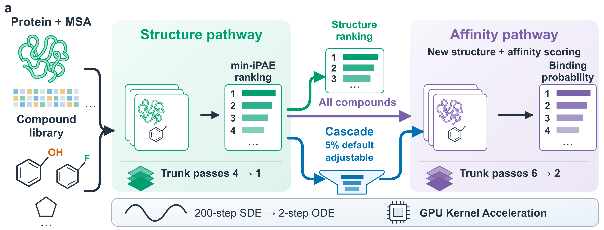

# BoltzVS: accelerated virtual screening with Boltz-2

BoltzVS accelerates Boltz-2 for protein–ligand virtual screening.
Its default configuration requires no additional training and retains the released architecture and weights.

It supports three workflows:

| Workflow | Ranking signal | Command |
|---|---|---|
| **Structure** | min-iPAE over the complete library | `boltz screen --stop-after-structure` |
| **Affinity** | binding probability over the complete library | `boltz predict` on affinity inputs |
| **Cascade** | structure prefilter, then affinity on the shortlist | `boltz screen` |



Both stages use the accelerated settings described in
[Advanced options](#advanced-boltz-predict-options). The cascade runs the inexpensive
structure pathway over the complete library, keeps the top 5% by min-iPAE, and applies
the more expensive affinity pathway only to that subset. Retention is set with `--keep`
(a fraction of the ranked library, `0.05` by default — the value used for the reported
benchmarks) or `--keep-n` (an exact number of compounds).

## Quick start

```bash
boltz screen \
  --receptor examples/Q00987.fasta \
  --library examples/Q00987.smi \
  --msa examples/msa/Q00987_0.csv \
  --out-dir run/
```

The bundled Q00987 example contains an 85-residue receptor and 200 compounds, with the receptor MSA included so the command needs no network access. With the default `--keep 0.05`, 10 compounds enter the affinity stage.

For your own receptor, drop `--msa` and `boltz screen` will obtain one MSA from the MSA server and reuse it throughout the library; pass `--msa` whenever you already have a Boltz-format MSA or the host has no outbound network:

```bash
boltz screen \
  --receptor receptor.fasta \
  --library library.smi \
  --msa receptor_0.csv \
  --out-dir run/
```

An interrupted run can be resumed with the same command and options. Completed stages and compounds are skipped; `--override` forces recomputation.

## Installation

```bash
conda create -n boltzvs python=3.10 -y
conda activate boltzvs

# Install PyTorch for the CUDA version on the host; CUDA 12.8 example:
pip install torch==2.9.0 torchvision==0.24.0 torchaudio==2.9.0 \
  --index-url https://download.pytorch.org/whl/cu128

git clone https://github.com/shiyu-wangbyte/BoltzVS.git
cd BoltzVS
pip install -e ".[cuda]"
```

Boltz-2 checkpoints and chemical-component resources are downloaded to the Boltz cache
on first use. Select another cache directory with `--cache`.

**The first run downloads about 7 GB** — the structure checkpoint (2.2 GB), the affinity
checkpoint (2.0 GB), and the chemical-component library, which is then extracted to
~45,000 files. On a 30 Mbit/s link this took about 30 minutes, during which the GPU sits
idle and the log is quiet: the run has not stalled. Subsequent runs reuse the cache and
start immediately.

BoltzVS runs upstream Boltz-2's cuEquivariance triangle kernels by default (`use_kernels`); `pip install ".[cuda]"` installs them. If they do not load in the local environment, disable them with `--no-kernels` (`boltz screen`) or `--no_kernels` (`boltz predict`): the pure-PyTorch fallback is slower but the workflow is unchanged.

This switch is **separate from the optional Anthropic kit** described below. The kit replaces the cuEquivariance path rather than layering on it, and is off unless `--trunk_kernels` is given. The two are alternatives, not a stack: `--no-kernels` cannot be combined with `--trunk_kernels` or `--affinity_kernels`, and the commands reject that combination instead of running a configuration where only some levers fall back.

### Docker

A self-contained image is the shortest route to a working install — it carries the
CUDA stack, so the host needs only a driver and the NVIDIA container runtime.

```bash
docker build -t boltzvs -f docker/Dockerfile .

docker run --gpus all --user "$(id -u):$(id -g)" \
  -v boltz_cache:/cache -v "$PWD":/work -w /work boltzvs \
  screen --receptor receptor.fasta --library library.smi --msa receptor_0.csv --out-dir run/
```

`--build-arg WITH_KERNELS=1` bakes the optional fused kernels in; without it the image
behaves like a plain install and `boltz install-kernels` still works inside a container.

If the build cannot reach Docker Hub, `--build-arg BASE=<mirror>/nvidia/cuda:12.8.0-base-ubuntu22.04`
substitutes a registry mirror. Check the mirror's digest against the official one before
trusting it — a digest is content-addressed, so a match rules out a substituted image.
Note that the daemon, not the client, pulls images: a proxy exported in your shell has no
effect, and must instead go in a systemd drop-in for `docker.service`.

Three things about the run command are worth keeping:

- **`-v boltz_cache:/cache`** — the ~7 GB of checkpoints are not in the image. They
  download into this named volume on first use and persist across runs and image
  rebuilds. On a host without outbound access to `model-gateway.boltz.bio`, mount a
  populated cache directly instead: `-v /path/to/.boltz:/cache`.
- **`--user "$(id -u):$(id -g)"`** — without it the container runs as root and every
  file it writes into `/work` is owned by root on the host.
- **`--gpus all`** — or `--gpus '"device=0"'` to pin one card on a shared machine.

The entrypoint is `boltz`, so the first argument is the subcommand (`screen`, `predict`,
`install-kernels`). Use `--entrypoint python` to get a shell interpreter instead.

### Optional: fused trunk kernels

`--trunk_kernels` applies the fused trunk kernels of Anthropic's
`uplifting-biomolecular-modeling` kit, a separate install. `--affinity_kernels` is a
different switch: it gives the **affinity model** the cuEquivariance triangle kernels
that ship with Boltz-2 (`.[cuda]`), which upstream passes to the structure model only.
When `--trunk_kernels` is also given, the kit serves the affinity pass too — that is why
the two flags are often used together. Both are **off by default and never required** —
every documented workflow runs with this repository alone. `boltz screen` exposes the
same switches with hyphens (`--trunk-kernels`, `--affinity-kernels`, `--kernel-row`);
`boltz predict` keeps the upstream underscore spelling used throughout this section. The
runtime benchmarks reported in the paper used Anthropic Kit (Apache-2.0 license) with
both structure and affinity kernel acceleration enabled. To add it:


```bash
boltz install-kernels          # clones the kit and installs the two packages
boltz install-kernels --check  # report only: is it installed and usable here?
```

Without the kit, `--trunk_kernels` prints why it did nothing and the run proceeds
unchanged. `--affinity_kernels` does not need the kit: it uses the cuEquivariance kernels
installed with `.[cuda]`.

The kernels raise peak GPU memory, and on a 24 GB card that can decide whether a large
target runs at all. `--kernel_row fast-lowmem` (with `--trunk_kernels`) drops one lever —
the MSA module's fused pair-weighted averaging — which measured 4.0 GB of peak on compute capability 8.6 and is
the difference between a 418-residue target producing 3 of 12 inputs and producing 11.
Reach for it before lowering `--chunk_size_threshold` (`--chunk-size-threshold` for `boltz screen`), which does not help this arm.
`--kernel_row big` selects the kit's own memory mode; it is slower and, on that card, did
not fit where `fast` did not, so measure before relying on it elsewhere.

## Inputs

### Receptor

`--receptor` accepts a protein FASTA. A precomputed MSA can be supplied with `--msa`; otherwise the MSA server is used once per receptor.

For a **multi-chain receptor**, repeat `--msa` once per chain, in FASTA order — Boltz needs a separate alignment for each chain, and a chain whose MSA does not match its sequence is quietly downgraded to single-sequence mode:

```bash
boltz screen --receptor dimer.fasta --library lib.smi \
  --msa chain_a.csv --msa chain_b.csv --ligand-id C --out-dir run/
```

Receptor chains take the ids `A`, `B`, ... in FASTA order, and the ligand defaults to `B`; when a receptor chain already uses that id, pass a free one such as `--ligand-id C` as above.

Automatic MSA generation (no `--msa`) remains single-chain only. Chains with identical sequences may be given the same file twice: the first chain's alignment is used for all of them, and handing one file to chains whose sequences differ is rejected.

### Compound library

`--library` accepts one SMILES per line, optionally followed by a compound name:

```text
CCO ethanol
CC(=O)Oc1ccccc1C(=O)O aspirin
```

Names should be unique. If a name is omitted, BoltzVS assigns one automatically.

### Structure guidance: templates and pocket constraints

Both are properties of the receptor, so they are written into **every** compound's input and used by both stages. Without these flags the inputs are unchanged.

```bash
boltz screen \
  --receptor receptor.fasta --library library.smi --msa receptor_0.csv \
  --template receptor_template.cif --template-chain A \
  --pocket A:45,A:46-48 --pocket-force \
  --out-dir run/
```

- **`--template`** (repeatable) takes a CIF/PDB file and is stored in the YAML as an absolute path. `--template-chain` / `--template-id` map input chains to template chains (comma-separated; Boltz picks the best match when omitted; `--template-id` must be paired with `--template-chain`). `--template-force` restrains the backbone and requires `--template-threshold` (Å).
- **`--pocket`** lists the receptor residues the ligand should contact, either `A:45` or plain `45` (chain defaults to `A`); ranges like `A:46-48` are accepted. It writes a Boltz `pocket` constraint whose binder is the ligand chain. `--pocket-max-distance` accepts 4–20 Å (default `6.0`); `--pocket-force` applies it as a potential rather than a feature.

Boltz's other constraint types (`bond`, token-level `contact`) are not exposed: they name specific ligand atoms, and SMILES ligands are named per compound (`C1`, `N2`, ...), so they do not carry across a library.

The recipe (MSA files, ligand id, templates, constraints) is recorded in `stage{1,2}_input.recipe.json` next to the generated inputs. Re-running with different values into the same `--out-dir` is refused rather than silently reusing the old YAMLs — pass `--override` or use a fresh directory.

## Outputs

All outputs are written below `--out-dir`:

| Path | Contents |
|---|---|
| `stage1_min_ipae.csv` | Complete library ranked by min-iPAE |
| `hits.csv` | Retained compounds ranked by `affinity_probability_binary` |
| `stage1/` | Raw structure-pathway predictions for the complete library |
| `stage2/` | Raw structure and affinity predictions for the retained subset |
| `stage1_input/`, `stage2_input/` | Generated Boltz YAML inputs for each stage |
| `stage1_input.done`, `stage2_input.done` | Markers used to resume an interrupted run |
| `stage1_input.recipe.json`, `stage2_input.recipe.json` | What the inputs were generated from (MSA, ligand id, templates, constraints) |
| `stage1_missing.txt`, `stage2_missing.txt` | Compounds absent from a stage and why (written only when non-empty) |
| `library_scaling_timing.json` | Written with `--timing`: library-scaling time components |

The two `*_input/` directories and their `.done` markers make `--override` and
resumption work; the `.recipe.json` files guard them against a changed recipe. All of
them can be deleted once a run is finished.

The final ranking uses `affinity_probability_binary`. The continuous regression output, `affinity_pred_value`, is included for reference but is not used by the cascade.

## Cascade options

| Option | Default | Purpose |
|---|---:|---|
| `--keep` | `0.05` | User-adjustable fraction retained after structure ranking |
| `--keep-n` | — | Retain a user-specified number instead of a fraction |
| `--stop-after-structure` | off | Stop after writing the min-iPAE ranking |
| `--msa` | — | Reuse a precomputed receptor MSA; repeat once per chain, in FASTA order |
| `--template` | — | CIF/PDB template applied to every compound; repeatable |
| `--template-chain` / `--template-id` | auto | Input/template chain mapping for the template |
| `--template-force` / `--template-threshold` | off / — | Restrain the backbone to the template (threshold in Å) |
| `--pocket` | — | Receptor residues the ligand should contact, e.g. `A:45,A:46-48` |
| `--pocket-max-distance` | `6.0` | Pocket contact distance, 4–20 Å |
| `--pocket-force` | off | Apply the pocket constraint as a potential |
| `--ligand-id` | `B` | Chain id for the ligand; change it when a receptor chain already uses `B` |
| `--variant` | `default` | Structure-stage configuration: `default` or the optional `d17` |
| `--student-pairformer` | — | D17 student weights; required with `--variant d17` |
| `--chunk-size-threshold` | `2048` | Pairformer chunking threshold; lower values reduce GPU-memory use |
| `--override` | off | Recompute existing predictions |
| `--timing` | off | Save library-scaling timing components; requires a fresh output directory |
| `--trunk-kernels` | off | Optional fused trunk kernels; see [above](#optional-fused-trunk-kernels) |
| `--kernel-row` | `fast` (with `--trunk-kernels`) | Which kit row those kernels apply; `fast-lowmem` when memory is tight |
| `--affinity-kernels` | off | cuEquivariance kernels for the affinity model (the kit needs `--trunk-kernels` too) |

Additional `boltz predict` options can be forwarded with repeated `--boltz-arg` arguments. A value that itself starts with a dash needs the `--boltz-arg=--flag` form (`--boltz-arg --flag` is rejected by argparse). For example:

```bash
boltz screen \
  --receptor receptor.fasta \
  --library library.smi \
  --msa receptor_0.csv \
  --out-dir run/ \
  --chunk-size-threshold 1024
```

The cascade defaults to `2048`, matching the reported benchmarks. Reduce the value on memory-constrained GPUs. Bare `boltz predict` defaults to `384`; the commands below set `2048` explicitly.

## What the cascade's two stages do

### Stage 1: structure prefilter

Every protein–ligand pair is predicted with the accelerated structure pathway. BoltzVS extracts min-iPAE—the minimum protein–ligand interface PAE—from each prediction and uses it to retain the most confident fraction of the library.

The default structure configuration uses two-step deterministic ODE sampling, reduced recycling, and mixed-precision matrix multiplication on the frozen Boltz-2 model. No additional training is required.

### Stage 2: affinity reranking

The retained compounds are submitted to the Boltz-2 affinity workflow with separately compressed affinity sampling and recycling. The affinity workflow includes the structure pass required by the affinity model, so the shortlisted compounds are predicted again in this stage. The final hit list is ranked by binding probability.

Restricting the affinity stage to a small, user-defined fraction of the library is the main workflow-level saving: the structure signal is used for broad, inexpensive prefiltering, while affinity scoring is reserved for the shortlist. The examples and reported benchmarks use the 5% default.

## The structure and affinity workflows

The cascade is one of three ways to use BoltzVS. The other two rank the **complete**
library by a single signal, and are the right choice when the shortlist should not be
decided by a prefilter — for example when the structure signal is unreliable for the
target, or when the affinity ranking is the result being reported.

### Structure workflow

Rank the whole library by min-iPAE. The simplest route is the cascade's own
structure stage:

```bash
boltz screen \
  --receptor receptor.fasta \
  --library library.smi \
  --msa receptor_0.csv \
  --out-dir run/ \
  --stop-after-structure
```

This writes `stage1_min_ipae.csv` for the complete library and stops.

To build the inputs by hand instead, prepare one structure-only Boltz YAML per
protein–ligand pair, then run:

```bash
boltz predict structure_inputs/ \
  --sampling_steps 2 \
  --gamma_0 0 \
  --step_scale 1 \
  --recycling_steps 0 \
  --matmul_precision medium \
  --chunk_size_threshold 2048 \
  --write_full_pae
```

Rank the resulting predictions by min-iPAE:

```bash
python min_ipae.py \
  --predictions boltz_results_structure_inputs/predictions \
  --receptor receptor.fasta
```

### Affinity workflow

Rank the whole library by binding probability, with no structure prefilter.
Affinity input YAMLs must declare `properties: affinity`. Boltz then runs its required structure pass followed by the affinity pass:

```bash
boltz predict affinity_inputs/ \
  --sampling_steps 2 \
  --gamma_0 0 \
  --step_scale 1 \
  --recycling_steps 0 \
  --matmul_precision medium \
  --sampling_steps_affinity 2 \
  --recycling_steps_affinity 1 \
  --diffusion_samples_affinity 5 \
  --chunk_size_threshold 2048
```

Use `affinity_probability_binary` to rank compounds. The five affinity diffusion samples are retained; reducing their number is not part of the validated configuration.

### Stock Boltz-2

Running `boltz predict` without the BoltzVS acceleration options retains the original Boltz-2 settings. This is also the recommended way to regenerate final structures for shortlisted compounds:

```bash
boltz predict shortlisted_structure_inputs/
```

## Optional: the D17 structure variant

The default configuration changes inference settings only.

D17 is an **optional** structure-stage alternative. It applies the same inference
settings, removes 17 Pairformer layers, and loads a self-distilled 47-layer student.
It affects only the structure pass; the affinity checkpoint remains full depth.

```bash
boltz screen \
  --receptor receptor.fasta \
  --library library.smi \
  --msa receptor_0.csv \
  --out-dir run_d17/ \
  --variant d17 \
  --student-pairformer student_pairformer_ft.pt
```

The D17 layer set is fixed to:

```text
2,3,4,5,6,7,16,18,19,26,27,28,29,30,31,32,33
```

For a standalone `boltz predict` run, pass `--drop_pairformer_layers` with that set
together with `--student_pairformer`; either flag alone is rejected.

The D17 distilled student weights (`student_pairformer_ft.pt`, ~552 MB) are deposited on
**Zenodo (DOI: [10.5281/zenodo.21642066](https://doi.org/10.5281/zenodo.21642066))** under
MIT, together with an archival snapshot of this repository and the distillation training
bundle. The 17-layer index set above must match the one the student was trained with.

The record is published with the manuscript; until then the DOI does not resolve and the
default configuration is the one to use.

## Timing and profiling

For a library-scaling benchmark, use a fresh output directory and add `--timing`:

```bash
boltz screen \
  --receptor receptor.fasta \
  --library library.smi \
  --msa receptor_0.csv \
  --out-dir timing_run/ \
  --timing
```

This writes `library_scaling_timing.json` plus timing files for the two internal stages. The reported total includes per-compound input processing, featurization, prediction, output writing, selection, and ranking. It excludes model download, model loading and device initialization, MSA generation, fixed chemical-component loading, and scheduler queue time. The file is written when the cascade finishes, so `--timing` with `--stop-after-structure` produces no timing file.

For a single `boltz predict` run, use `--library_timing_file <file.json>`. The existing `--profile` option provides a lower-level forward-pass breakdown and is intended for diagnostics rather than workflow timing.

Both are **single-device measurements**. With `--devices` greater than 1 they are rejected rather than producing numbers that mix ranks: every rank would write the same timing file, and `--profile` synchronizes inside every forward.

## Scope and limitations

- **Ranking, not final geometry.** The two-step sampling configuration preserves overall screening performance while reducing runtime. Two-step sampling can distort ligand covalent geometry. Regenerate shortlisted structures with stock Boltz-2 before pose inspection or interaction analysis.
- **Use binding probability.** The accelerated affinity pathway preserves `affinity_probability_binary` substantially better than the continuous `affinity_pred_value`; the latter is not a cascade ranking signal.
- **Affinity benchmarks may overlap with training data.** The Boltz-2 affinity checkpoint was trained on broad public bioactivity collections. Absolute affinity enrichment on benchmarks sharing those sources is not a leakage-controlled generalisation test. BoltzVS therefore treats those comparisons as fidelity to the corresponding Stock Boltz-2 workflow.

## Advanced `boltz predict` options

These are the `boltz predict` spellings. `boltz screen` exposes some of the same knobs as
its own options, with hyphens (`--chunk-size-threshold`, `--trunk-kernels`,
`--affinity-kernels`, `--kernel-row`, `--student-pairformer`); the sampling, recycling and
precision settings are fixed by the cascade's defaults. `boltz screen` does not accept
the underscore forms.

| Option | Stock Boltz-2 | BoltzVS accelerated configuration | Scope |
|---|---:|---:|---|
| `--sampling_steps` | `200` | `2` | Structure sampler |
| `--gamma_0` | model default | `0` | Structure sampler |
| `--step_scale` | model default | `1` | Structure sampler |
| `--recycling_steps` | `3` | `0` | Structure trunk |
| `--matmul_precision` | `highest` | `medium` | Structure computation |
| `--sampling_steps_affinity` | `200` | `2` | Affinity sampler |
| `--recycling_steps_affinity` | `5` | `1` | Affinity trunk |
| `--diffusion_samples_affinity` | `5` | `5` | Affinity samples |
| `--inference_batch_size` | `1` | user-selected | Per-GPU batching, structure pass only (the affinity pass always runs at `1`) |
| `--chunk_size_threshold` | `384` | `2048` | Memory/speed trade-off |
| `--drop_pairformer_layers` | — | D17 only | Structure trunk depth |
| `--student_pairformer` | — | D17 only | Distilled structure weights |
| `--trunk_kernels` | off | off | Optional fused trunk kernels (separate install) |
| `--affinity_kernels` | off | off | cuEquivariance kernels for the affinity model (the kit needs `--trunk_kernels` too) |
| `--kernel_row` | — | `fast` | Which kit row `--trunk_kernels` applies (requires `--trunk_kernels`): `fast`, `fast-lowmem` (≈4 GB cheaper), `big` |

`--recycling_steps_affinity`, `--drop_pairformer_layers`, `--student_pairformer`, the two `*_kernels` flags and the cascade interface are additions in this fork.

## Relationship to Boltz

BoltzVS is derived from [jwohlwend/boltz](https://github.com/jwohlwend/boltz), the reference implementation of Boltz-1 and Boltz-2. Bare `boltz predict` retains the upstream model settings; the cascade and acceleration options are opt-in. The released Boltz-2 checkpoints remain the basis of both cascade stages. `boltz predict` retains the full Boltz-2 input language, including templates and bond/pocket/contact constraints; `boltz screen` exposes templates and pocket constraints directly (see [Structure guidance](#structure-guidance-templates-and-pocket-constraints)).

## Citation

If you use BoltzVS, please cite the forthcoming BoltzVS paper and the upstream models:

- Boltz-2: <https://doi.org/10.1101/2025.06.14.659707>
- Boltz-1: <https://doi.org/10.1101/2024.11.19.624167>
